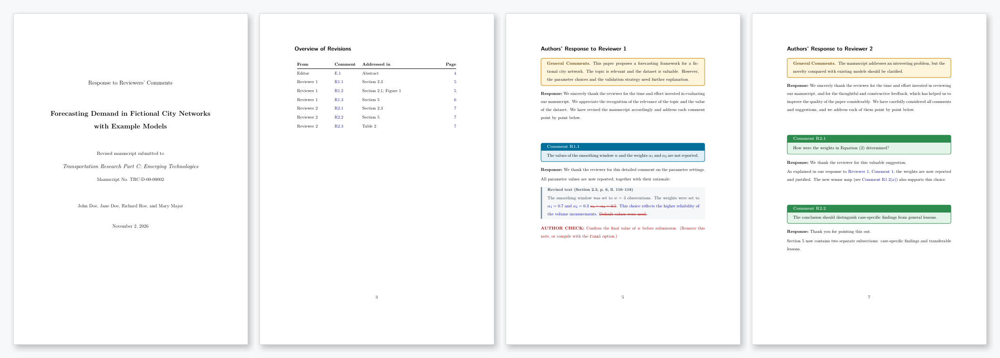

<div align="center">

# authorresponseletter

**A LaTeX class for clear, well-organised author response letters to journal reviewers**

[](authorresponseletter.cls)
[](authorresponseletter.cls)
[](LICENSE)
[](#installation)
[](#requirements)
[](#requirements)

[Features](#features) •
[Quick start](#quick-start) •
[Examples](#examples) •
[Options](#class-options) •
[Reference](#reference) •
[Acknowledgements](#acknowledgements-and-related-projects)



</div>

---

## Features

| | |
|---|---|
| 🎨 **Colour per reviewer** | Each reviewer gets their own colour; general comments share one colour |
| 🔢 **Smart numbering** | Comments numbered **R1.3**, **E.1** — or plain **1, 2, 3** |
| 🔗 **Cross-references** | `\commentref{r1:c3}` prints a linked "Reviewer 1, Comment 3" |
| 📋 **Overview table** | `\printoverview` lists every comment, where it was addressed, and its page |
| ✉️ **Cover letter** | Formatted letter to the editor with signature and closing |
| 🙏 **Thank-you notes** | Rotating automatic phrases, your own sentence, or none |
| ✏️ **Revised text** | Quote new manuscript text with its location; mark `\added`, `\deleted`, `\replaced` |
| 🔤 **Sub-points** | Number a reviewer's points (a), (b), … and answer each one |
| 📝 **Co-author notes** | `\authorcheck{...}` notes, hidden by the `final` option |
| 📄 **Page breaks** | Long comment boxes continue onto the next page |
| 🖨️ **Print-friendly** | `greyscale` and `compact` options |

## Quick start

Put `authorresponseletter.cls` next to your `.tex` file and compile **twice**:

```latex
\documentclass[11pt]{authorresponseletter}
\usepackage{hyperref}

\title{A Placeholder Study of Example Systems}
\author{John Doe and Jane Doe}
\journal{PLOS ONE}
\manuscript{PONE-D-00-00001}

\begin{document}
\maketitle

\reviewer
\begin{generalcomment}
The manuscript is interesting but needs minor revisions.
\end{generalcomment}
\begin{generalresponse}
\end{generalresponse}

\begin{revcomment}
\label{r1:c1}
Please clarify the data collection.
\end{revcomment}
\begin{revresponse}
\addressedin{Section~2}
Section~2 now describes the data collection in detail.
\end{revresponse}
\end{document}
```

## Installation

| Where | How |
|---|---|
| **Overleaf** | Upload `authorresponseletter.cls` to your project |
| **Single project** | Copy `authorresponseletter.cls` into the folder of your `.tex` file |
| **All projects** | Copy it to `TEXMFHOME/tex/latex/authorresponseletter/` (find `TEXMFHOME` with `kpsewhich -var-value TEXMFHOME`) |

## Examples

| File | Journal | Shows |
|---|---|---|
| [`01-minimal`](examples/01-minimal.tex) ([PDF](examples/01-minimal.pdf)) | PLOS ONE | The smallest useful letter and the three ways to open a response |
| [`02-full-features`](examples/02-full-features.tex) ([PDF](examples/02-full-features.pdf)) | Transportation Research Part C | Cover letter, overview table, editor and two reviewers, cross-references, sub-points, revised text, author notes |
| [`03-class-options`](examples/03-class-options.tex) ([PDF](examples/03-class-options.pdf)) | IEEE Transactions on ITS | `final`, `greyscale`, `compact`, `plainnumbers`, `noautothanks` |
| [`04-customisation`](examples/04-customisation.tex) ([PDF](examples/04-customisation.pdf)) | Scientific Reports | Own colours, thank-you phrases, general response and title-page wording; three reviewers |

> [!NOTE]
> To build the examples, run `latexmk 01-minimal.tex` inside `examples/` (the included `.latexmkrc` finds the class in the parent folder), or copy the class file into `examples/`.

## Class options

```latex
\documentclass[11pt,final,compact]{authorresponseletter}
```

| Option | Effect |
|---|---|
| `final` | Hides all `\authorcheck` notes (a warning still reports how many remain) |
| `greyscale` | Black-and-white output for printing |
| `compact` | Tighter line spacing and smaller gaps between responses |
| `plainnumbers` | "Comment 3" instead of "Comment R1.3" |
| `noautothanks` | No automatic thank-you phrase |
| `continuousthanks` | Thank-you phrases do not restart for each reviewer |

Any other option (`11pt`, `a4paper`, `english`, …) is passed on to `scrartcl`.

## Reference

<details open>
<summary><b>Document setup (preamble)</b></summary>

| Command | Purpose |
|---|---|
| `\title{}`, `\author{}`, `\date{}` | Title page |
| `\journal{}`, `\manuscript{}` | Journal name and manuscript number |
| `\titleheading{}` | Top line of the title page (default: *Response to Reviewers' Comments*) |
| `\submittedto{}` | Line above the journal (default: *Revised manuscript submitted to*) |
| `\signature{}` | Name under the cover letter (default: `\author`) |
| `\onbehalf{}` | Line under the signature (default: *On behalf of all authors*; empty removes it) |
| `\letterclosing{}` | Closing of the cover letter (default: *Yours sincerely,*) |

</details>

<details open>
<summary><b>Structure</b></summary>

| Command / environment | Purpose |
|---|---|
| `\maketitle` | Title page |
| `coverletter` | Letter to the editor; optional greeting: `\begin{coverletter}[Dear Prof. Doe,]` |
| `\printoverview` | Overview table of all comments |
| `\editor` | Starts the response to the editor |
| `\reviewer` | Starts the response to the next reviewer |

</details>

<details open>
<summary><b>Comments and responses</b></summary>

| Command / environment | Purpose |
|---|---|
| `generalcomment` | Reviewer's general comment (shared colour) |
| `generalresponse` | Default general response · `[Text]` your own opening · `[]` none |
| `revcomment` | A numbered comment |
| `revresponse` | No argument → automatic thank-you · `[Text]` your own · `[]` none |
| `subcomments`, `subresponses` | Points (a), (b), … inside a comment or response, using `\item` |
| `revision` | Quoted revised text; `\begin{revision}[Section 2.3, p.~7]` adds the location |
| `\added{}`, `\deleted{}`, `\replaced{new}{old}` | Inline changes |
| `\addressedin{}` | Location shown in the overview table (inside `revresponse`) |
| `\authorcheck{}` | Note for co-authors; hidden with the `final` option |
| `concludingresponse` | Closing box at the end of a reviewer section |

</details>

<details>
<summary><b>Cross-references</b></summary>

Put `\label{...}` inside a `revcomment` (or after `\item` in `subcomments`):

| Command | Output |
|---|---|
| `\commentref{r1:c3}` | Reviewer 1, Comment 3 |
| `\commentref*{r1:c3}` | Comment R1.3 |
| `\ref{r1:c3}` | R1.3 |

</details>

<details>
<summary><b>Thank-you phrases</b></summary>

| Command | Purpose |
|---|---|
| `\clearthankyou` | Remove the built-in phrases |
| `\addthankyou{}` | Add a phrase (`\therecipient` prints "reviewer" or "editor") |
| `\thankyou{n}` | Print phrase *n*, e.g. `\begin{revresponse}[\thankyou{3}]` |
| `\autothanksoff`, `\autothankson` | Switch automatic phrases off or on |
| `\generalresponsetext{}` | Replace the default general response |

</details>

<details>
<summary><b>Colours and links</b></summary>

| Command | Purpose |
|---|---|
| `\setreviewercolors{n}{text}{background}{frame}` | Colours for reviewer *n* (or `editor`) |
| `\setgeneralcolors{text}{background}{frame}` | Colours of the general comment boxes |
| `\hypersetup{allcolors=...}` | Link colour (default: dark blue; black with `greyscale`) |

Six reviewer schemes are built in — blue, green, purple, crimson, teal, brown. Reviewer 7 starts again at blue.

</details>

## Requirements

- A LaTeX installation from **2020 or later** (TeX Live, MiKTeX or Overleaf)
- Tested with **pdfLaTeX**, **LuaLaTeX** and **XeLaTeX**
- Packages (all part of a standard installation): `koma-script`, `tcolorbox`, `xcolor`, `kvoptions`, `intcalc`, `longtable`, `array`, `ulem`. If `ulem` is missing, the class still compiles and deleted text is shown in brackets.

> [!TIP]
> Compile twice so that the overview table and the cross-references are filled in.

> [!NOTE]
> If you load the `changes` package, its `\added`, `\deleted` and `\replaced` take precedence over the class versions.

## Acknowledgements and related projects

This class would not exist without the work of others who shared their response letter templates with the community. We are grateful to the authors and contributors of the projects below. Their ideas on structuring point-by-point responses, highlighting reviewer comments, and making the revision process less tedious have influenced the design of this class. In particular, the visual style of the comment boxes and the overall document structure were inspired by Karl-Ludwig Besser's `reviewresponse` template.

If this class does not fit your workflow, these projects are excellent alternatives:

- [klb2/review-response-template](https://github.com/klb2/review-response-template) — Karl-Ludwig Besser's `reviewresponse` class with coloured comment boxes and `biblatex` support (also on [Overleaf](https://www.overleaf.com/latex/templates/review-response-template/tmbvmjstxwrd))
- [jourrr](https://ctan.org/pkg/jourrr) ([GitHub](https://github.com/firefly-cpp/latex-response-reviewers)) — rebuttal letter class on CTAN with response ticks, custom valedictions and an optional table of contents
- [rebuttal](https://ctan.org/pkg/rebuttal) — CTAN package for structured journal and conference rebuttals with cross-referenced changes
- [shellywhen/Journal-Response-Letter-Template-LaTeX](https://github.com/shellywhen/Journal-Response-Letter-Template-LaTeX) — response letter template, initially designed for IEEE TVCG
- [mschroen/review_response_letter](https://github.com/mschroen/review_response_letter) — LaTeX class for author response letters to review comments
- [GjjvdBurg/LaTeXReviewReplyTemplate](https://github.com/GjjvdBurg/LaTeXReviewReplyTemplate) — template for replying to paper reviews with cross-referenced points
- [cdc08x/letter-2-reviewers-LaTeX-template](https://github.com/cdc08x/letter-2-reviewers-LaTeX-template) — letter-to-reviewers template

## License

Released under the [GNU General Public License v3.0](LICENSE).

